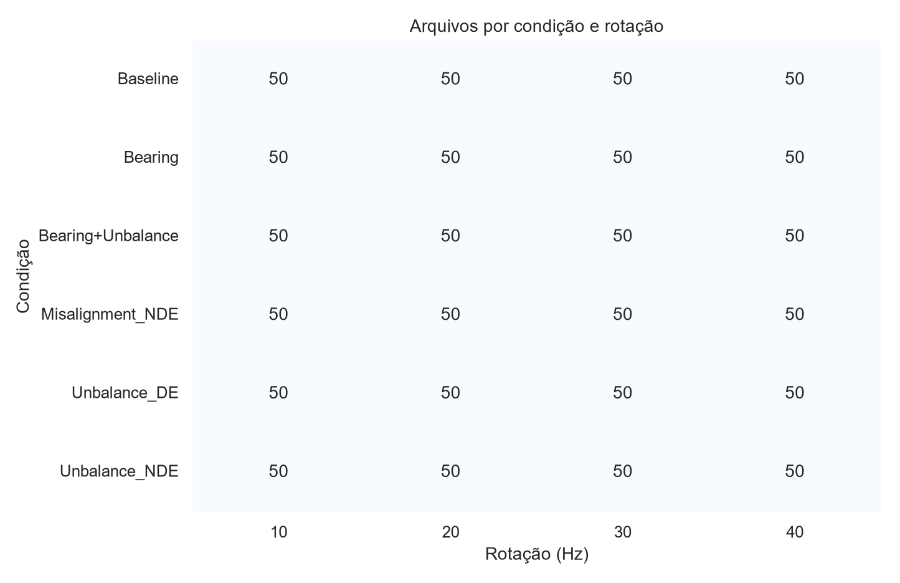
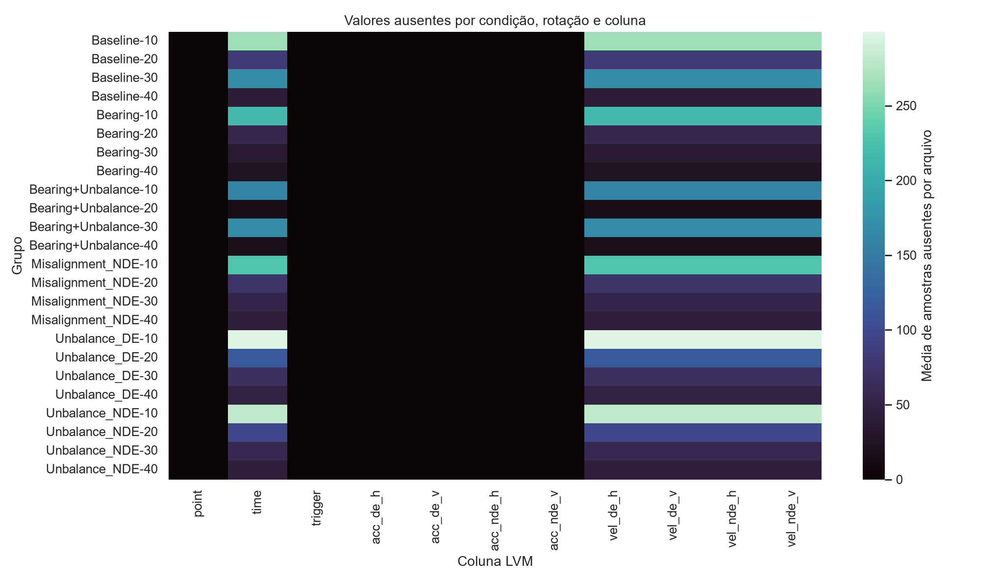
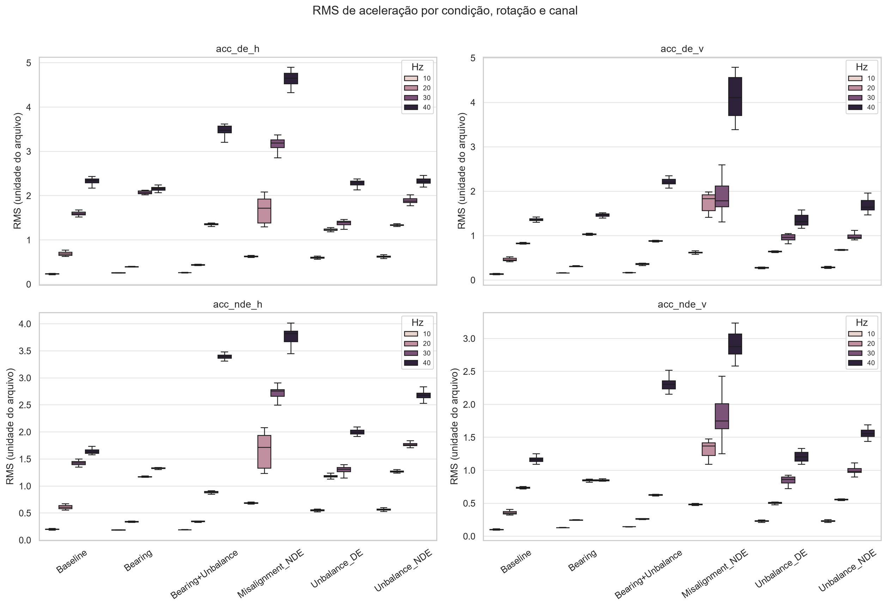
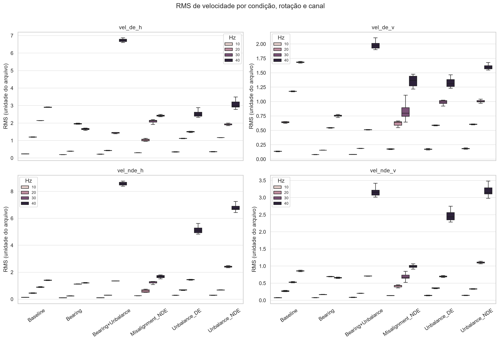
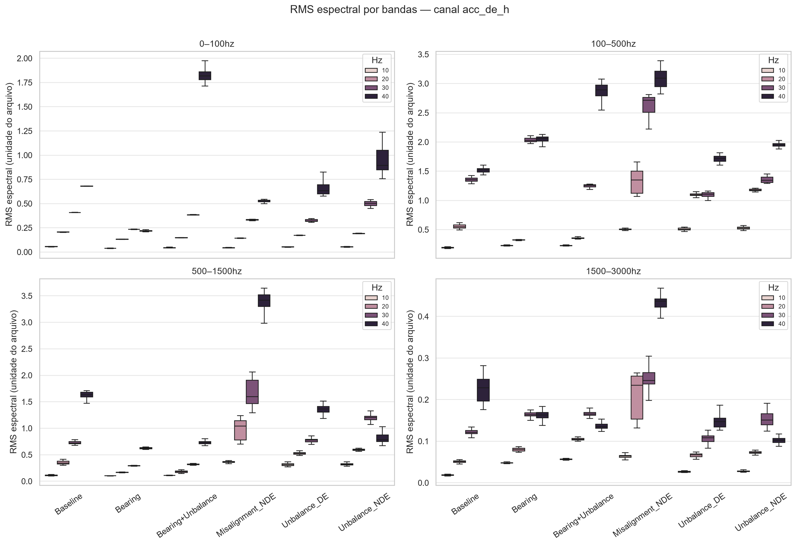
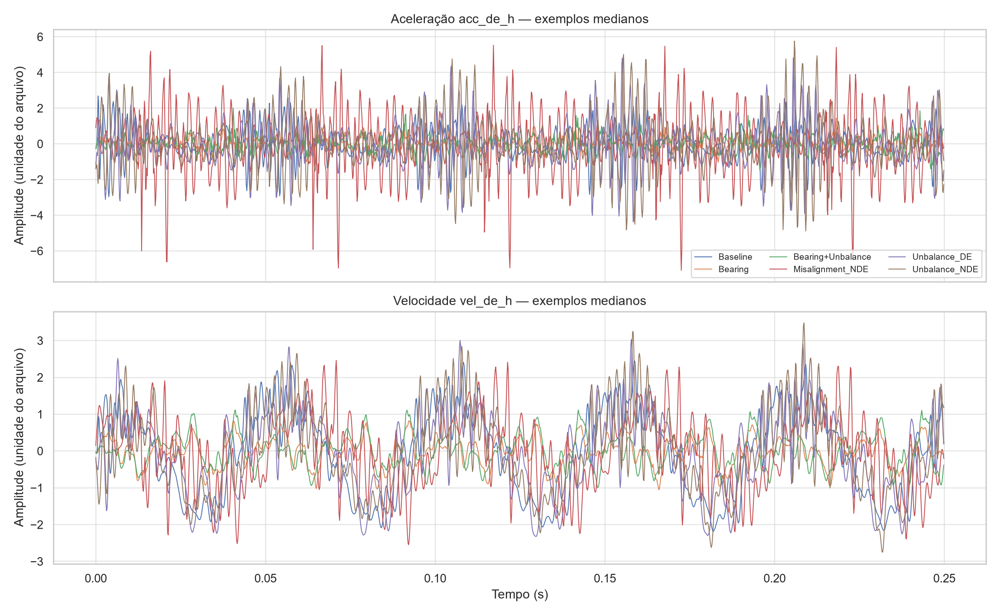
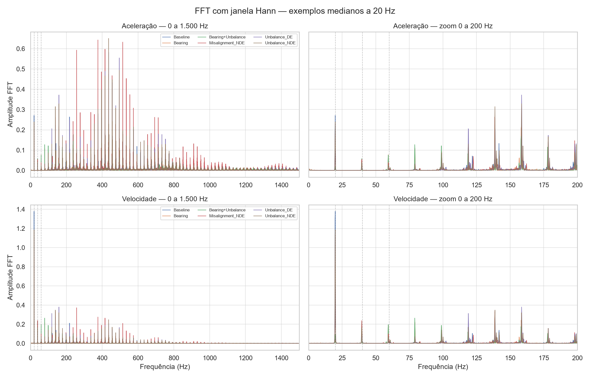

# EDA dos sinais de vibração

## Escopo e objetivo

Esta análise explora os sinais medidos do conjunto [Vibration signals of different fault conditions in a generic rotating machine](https://zenodo.org/records/14388093). O objetivo é entender como as seis condições e as quatro rotações aparecem nos sinais antes de treinar qualquer classificador. **Nenhum modelo de Machine Learning foi treinado nesta etapa.**

Os arquivos `.lvm` foram lidos um a um. As tabelas calculadas são locais e ignoradas pelo Git; o notebook contém as etapas para repetir a análise a partir dos dados brutos baixados.

## Estrutura encontrada

- **1.200 arquivos** `.lvm`, cada um com 36.000 linhas e 11 colunas numéricas após a leitura.
- **Seis condições**, com 200 sinais cada: `Baseline`, `Bearing`, `Bearing+Unbalance`, `Misalignment_NDE`, `Unbalance_DE` e `Unbalance_NDE`.
- Cada condição tem **50 sinais em cada rotação**: 10, 20, 30 e 40 Hz.
- Quatro canais de aceleração (`acc_*`) e quatro canais de velocidade (`vel_*`), além de ponto, tempo e trigger.
- Os arquivos ocupam aproximadamente 3,86–3,90 MB cada. Os nomes e as pastas permitem obter condição e rotação; o arquivo LVM não contém explicitamente o rótulo de falha como uma coluna.

Há uma inconsistência textual no registro do dataset: a descrição menciona “4 different fault conditions”, mas enumera seis pastas/condições incluindo Baseline. A contagem local confirma seis grupos de 200 arquivos; esta análise usa a estrutura efetiva dos arquivos e a enumeração detalhada do registro.

## Qualidade, ausências e anomalias candidatas

Todos os 1.200 arquivos foram lidos sem erro e tinham 36.000 linhas. Não foram encontrados valores ausentes em `point`, `trigger` ou nos quatro canais de aceleração.

`time` e cada canal de velocidade têm exatamente o mesmo padrão de ausências: **132.829 valores ausentes por coluna** no conjunto. Isso equivale a cerca de 0,31% das posições possíveis por coluna, ou 110,7 valores por arquivo em média. A quantidade varia por arquivo: de 1 a 310 pontos. A validação das posições confirmou que as ausências ocorrem apenas no final da sequência, sem lacunas internas. Esse padrão é consistente com a documentação, que informa que tempo e velocidade terminam no último flanco ascendente do trigger. Para a análise, cada feature usa os valores finitos disponíveis; não houve imputação.

Para triagem de comportamento atípico, foram sinalizados valores de RMS com *modified z-score* maior que 3,5 dentro do mesmo par condição-rotação. O critério marcou pelo menos um canal em **51 arquivos**. Esses são candidatos para inspeção, não erros confirmados: algumas classes e rotações podem ter variabilidade real e a regra robusta não conhece limites físicos do equipamento. Não foi aplicado um limite de saturação ou ruído porque o registro não fornece unidades calibradas nem limites operacionais dos sensores.

## Estatísticas no domínio do tempo

Para cada arquivo e cada canal foram calculados média, desvio padrão amostral, variância amostral, RMS, curtose de Fisher, assimetria, pico absoluto, pico a pico e fator de crista. As métricas foram calculadas sobre as amostras finitas. O RMS corresponde à raiz da média do quadrado; o pico é o máximo do valor absoluto.

Nos canais de aceleração e velocidade, RMS e desvio padrão praticamente coincidem: a diferença relativa mediana entre eles foi aproximadamente `0,000014`. As médias dos sinais são muito próximas de zero, como esperado para sinais oscilatórios centrados. Portanto, neste conjunto, RMS/desvio padrão são mais informativos que a média isolada.

O efeito da rotação é forte. Agrupando as classes, a mediana de RMS em `acc_de_h` cresce de **0,419 a 10 Hz** para **2,346 a 40 Hz**. A correlação de Spearman entre rotação e RMS ficou entre **0,83 e 0,95** nos oito canais. Essa associação é descritiva e combina todas as classes; ela mostra por que a rotação precisa ser controlada ao comparar falhas.

### Exemplo de comparação a 20 Hz

Na aceleração horizontal do lado acoplado (`acc_de_h`), as medianas de RMS por condição foram:

| Condição | RMS mediano em `acc_de_h`, 20 Hz |
|---|---:|
| Baseline | 0,685 |
| Bearing | 0,395 |
| Bearing+Unbalance | 0,437 |
| Misalignment_NDE | 1,719 |
| Unbalance_DE | 1,227 |
| Unbalance_NDE | 1,334 |

O desalinhamento NDE apresenta RMS claramente maior que Baseline neste canal e rotação. As duas classes de desbalanceamento também têm medianas maiores; `Bearing` e `Bearing+Unbalance` ficam abaixo de Baseline nesse recorte. Isso mostra que uma regra do tipo “RMS maior significa falha” não serve para todas as classes.

Ao comparar todas as rotações e os quatro canais de aceleração, a média dos quocientes entre as medianas de cada falha e as medianas Baseline foi 2,94 para `Misalignment_NDE`, 1,69 para `Unbalance_NDE`, 1,54 para `Unbalance_DE`, 1,13 para `Bearing+Unbalance` e 0,94 para `Bearing`. As faixas desses quocientes variam bastante entre canal e rotação; esses valores agregados descrevem tendências, não limiares universais.

As estatísticas de forma também não separam todas as classes sozinhas. Por exemplo, a curtose mediana em `acc_de_h` a 20 Hz varia de 0,25 em `Bearing` até cerca de 1,22 em `Unbalance_NDE`, mas várias outras condições ficam entre esses valores. A distribuição completa e os quantis por grupo estão em `data/processed/eda_group_summary.csv`.

## Domínio da frequência

Para cada canal foi estimado um periodograma de um lado com janela Hann e frequência de amostragem de 6 kHz. A integração da densidade espectral em bandas gera RMS espectral por arquivo nas faixas 0–100, 100–500, 500–1.500 e 1.500–3.000 Hz. Essas bandas são resumos exploratórios; não foram tratadas como frequências características diagnósticas universais.

No canal `acc_de_h` a 20 Hz, a banda 100–500 Hz tem RMS espectral mediano 0,55 em Baseline, 0,32 em Bearing, 0,35 em Bearing+Unbalance, 1,35 em Misalignment_NDE, 1,10 em Unbalance_DE e 1,18 em Unbalance_NDE. Na banda 500–1.500 Hz, os valores correspondentes são 0,34, 0,17, 0,18, 1,04, 0,53 e 0,59. Nesse recorte, as bandas intermediárias destacam mais o desalinhamento que a banda 0–100 Hz.

O gráfico abaixo mostra FFTs de sinais a 20 Hz escolhidos por terem RMS `acc_de_h` mais próximo da mediana de sua condição. Ele inclui aceleração e velocidade no lado acoplado. As linhas tracejadas indicam 1x, 2x e 3x a rotação (20, 40 e 60 Hz). Há picos harmônicos e componentes fora desses pontos; a aparência dos espectros varia por condição. Um arquivo representativo por classe é útil para ilustrar, mas não demonstra por si só uma assinatura estável em todos os 50 arquivos da classe.

## Conclusão em linguagem simples

Esta EDA é uma primeira leitura da “assinatura” de vibração da máquina. Ela organiza os 1.200 registros, verifica se os sinais estão completos e resume sua intensidade e suas frequências. É como olhar os sinais com atenção antes de ensinar um computador a reconhecer falhas.

Encontramos seis condições com a mesma quantidade de registros e quatro velocidades bem representadas. A maior parte dos dados está íntegra. O tempo e a velocidade terminam um pouco antes da aceleração em alguns arquivos; esse trecho final ausente é esperado pelo modo de aquisição descrito na fonte.

Um achado importante é que a máquina vibra mais quando gira mais rápido. Por isso, uma vibração de amplitude maior não significa automaticamente que há uma falha: precisamos comparar sinais na mesma rotação. Em um exemplo de aceleração horizontal a 20 Hz, a mediana de RMS foi 0,685 para Baseline e 1,719 para desalinhamento NDE. Já a condição Bearing teve 0,395 nesse mesmo canal. Isso mostra que cada tipo de falha pode alterar os sinais de uma forma diferente.

O desalinhamento NDE (`Misalignment_NDE`: desalinhamento no lado oposto ao acoplamento do motor) é a pista mais clara até aqui: em vários canais e faixas de frequência, seus valores aparecem maiores que os de Baseline (máquina sem falha simulada). Para Bearing (falha no rolamento) e Bearing+Unbalance (falha no rolamento junto com desbalanceamento), o RMS (medida resumida da intensidade da vibração) se sobrepõe mais ao comportamento normal, então esse resumo sozinho não basta para diferenciá-los. Também encontramos 51 arquivos que merecem uma olhada mais cuidadosa; eles foram marcados por uma regra estatística e ainda não sabemos se são medições problemáticas ou variações reais.

**O que isso significa para o projeto:** já temos uma base organizada e pistas sobre quais sinais podem ajudar a reconhecer algumas condições. Ainda não sabemos quão bem um classificador funcionará. Esta análise não treinou nem avaliou um modelo; ela prepara a próxima etapa e ajuda a evitar comparações injustas entre velocidades.

## Limites importantes

O conjunto vem de uma única máquina com falhas simuladas. Não contém histórico de degradação, então não permite estimar quando uma peça vai falhar. As unidades físicas dos canais também precisam ser confirmadas antes de interpretar os valores como limites de operação. Além disso, velocidade foi calculada por integração da aceleração, então os dois sinais são relacionados.

## Interpretação e limitações

1. **A rotação é um fator dominante.** RMS aumenta fortemente com a rotação em todos os canais. A avaliação futura deve comparar classes dentro de cada velocidade e também testar generalização para uma rotação não vista.
2. **Misalignment_NDE é o padrão mais evidente nesta EDA.** Ele exibe RMS de aceleração e energia nas bandas 100–1.500 Hz maiores em vários recortes. Isso é uma pista descritiva que deve ser confirmada em validação por arquivo.
3. **RMS não separa todas as condições.** `Bearing` e `Bearing+Unbalance` não se distinguem de Baseline de forma consistente por RMS em todos os canais e rotações; as distribuições também apresentam sobreposição.
4. **Aceleração e velocidade não são fontes independentes.** O registro informa que velocidade foi calculada pela integração da aceleração; usar ambos pode duplicar informação e deve ser avaliado, não presumido como ganho.
5. **O conjunto é de uma máquina e condições simuladas.** Não há histórico de degradação, rótulos de severidade ou variedade de máquinas/ambientes para sustentar prognóstico de vida útil ou alegações de desempenho industrial.
6. **Unidades e calibração não foram estabelecidas nesta análise.** Por isso os gráficos usam “unidade do arquivo”; valores absolutos não devem ser interpretados como limites de segurança ou diagnóstico físico.
7. **Outliers estatísticos não são necessariamente defeitos de aquisição.** Os 51 candidatos sinalizados precisam ser inspecionados com contexto experimental antes de qualquer exclusão.

## Próximos passos recomendados

- Confirmar com o artigo e os metadados experimentais quais unidades, posições dos sensores e condições físicas correspondem a cada canal e pasta.
- Revisar os 51 arquivos candidatos a outlier e alguns sinais de cada classe, verificando saturação, transientes ou diferenças de aquisição.
- Construir a tabela de modelagem com uma linha por arquivo, mantendo rotação e identificador do arquivo como metadados.
- Antes de modelar, definir avaliação agrupada por arquivo e resultados separados por rotação; comparar primeiro features temporais com features espectrais.

## Reproduzir

Todo o código da análise está em [`notebooks/03-eda.ipynb`](../notebooks/03-eda.ipynb), dividido em células por etapa. Abra-o no PyCharm/Jupyter, confirme que o diretório de dados aponta para `data/raw` e execute as células em ordem. A célula de processamento percorre os 1.200 arquivos e pode levar alguns minutos. Não é necessário importar módulos EDA de `src/`.

O notebook gera:

- `data/processed/eda_features.csv`: uma linha por arquivo, com features temporais, RMS espectral por canal e flags exploratórias de RMS;
- `data/processed/eda_quality.csv`: linhas, contagens válidas, ausências e ausências internas por arquivo/coluna;
- `data/processed/eda_group_summary.csv`: médias, medianas, desvios e quartis por condição, rotação, canal e feature;
- as figuras PNG em `docs/figures/eda/`.

Os CSVs processados ficam fora do Git conforme o `.gitignore`; o notebook, as figuras e este relatório podem ser versionados.
